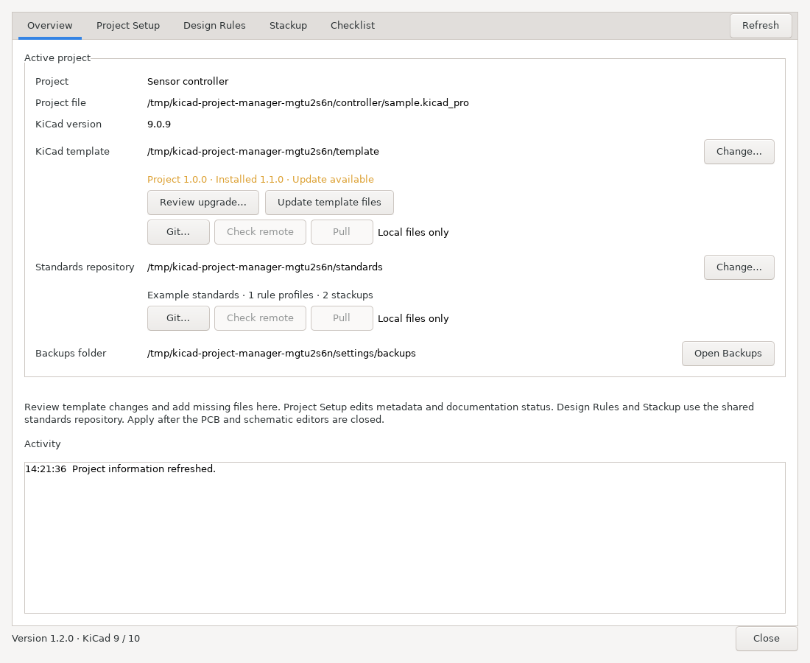
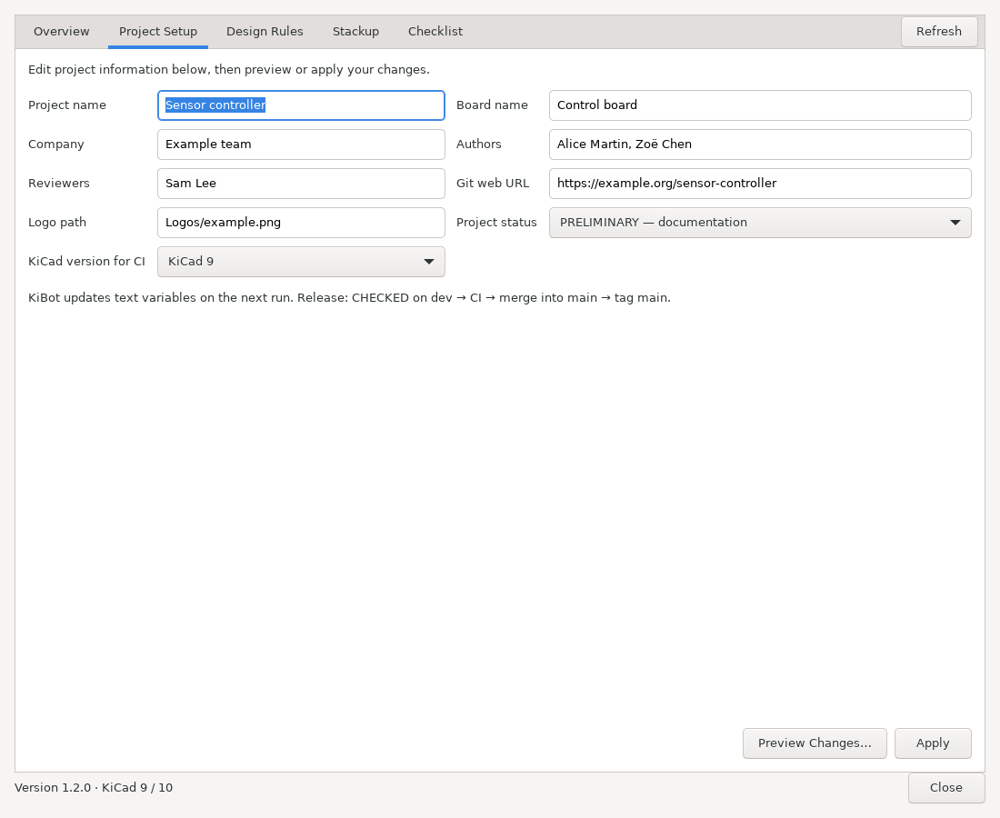
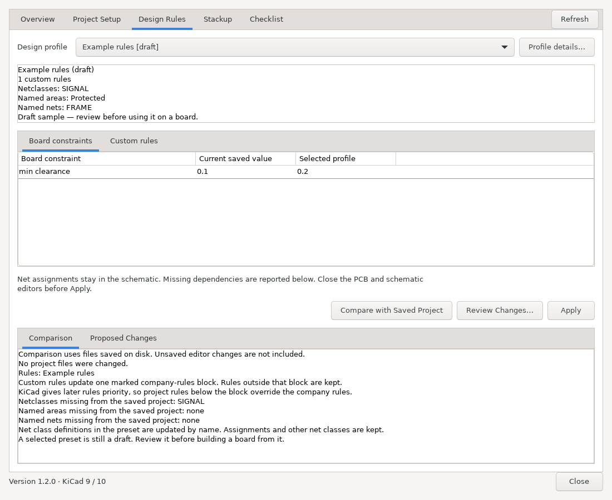
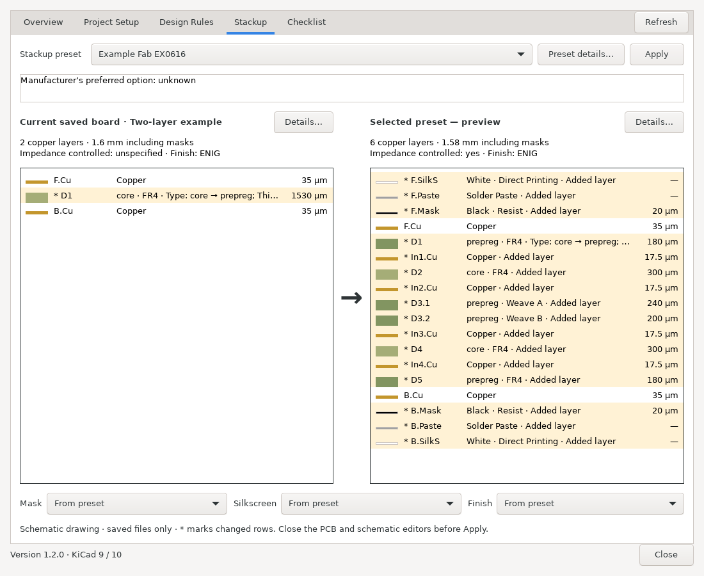
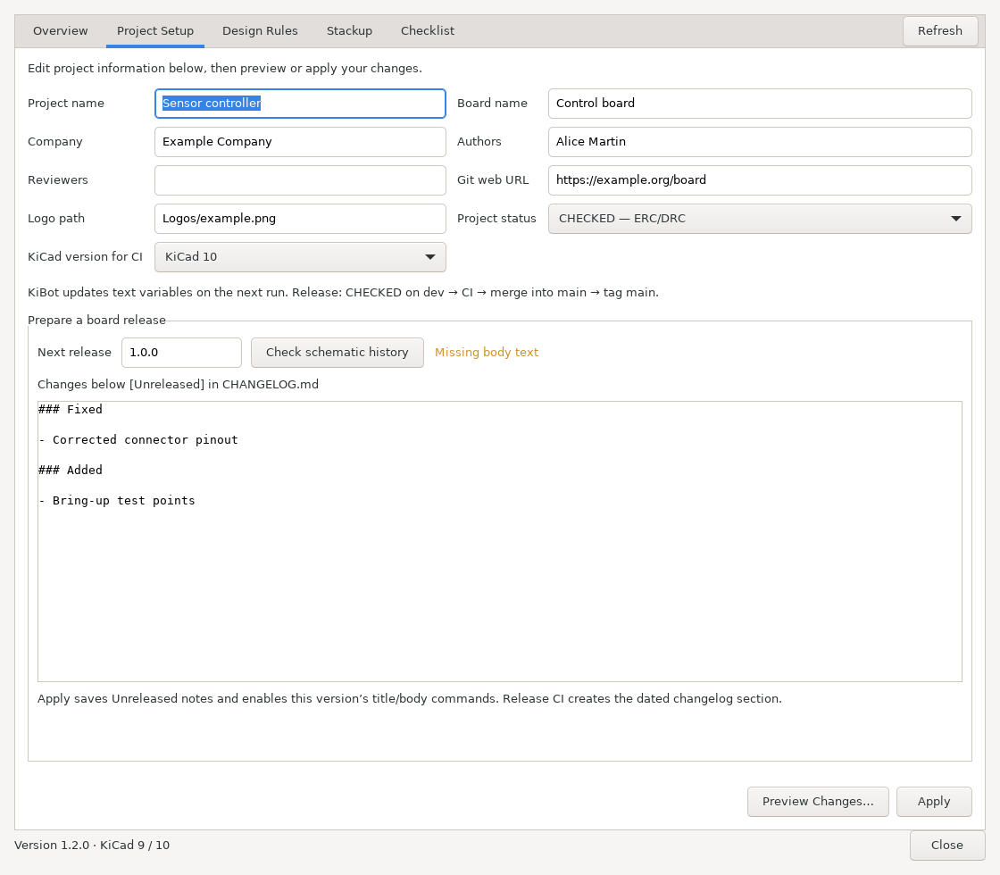
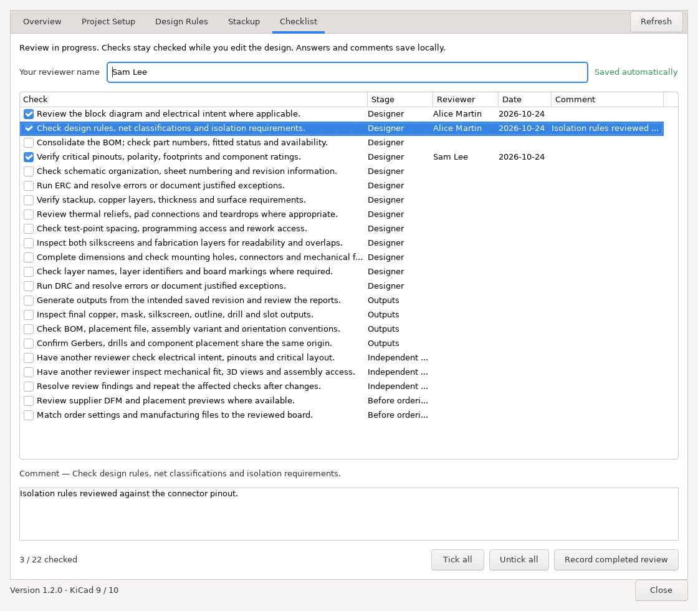

# KiCad Project Manager

A native **KiCad 9 / 10** plugin for KiBot project setup, template updates, design
rules and PCB stackups. Use your own compatible templates and standards folders.

## Install

1. Enable **Preferences → Plugins → Enable KiCad API**. Use KiCad’s bundled
   Python on macOS, Windows and Linux AppImage installations. For native
   Debian/Ubuntu packages, install `python3-pip python3-venv python3-wxgtk4.0`
   and select the system Python.
2. Download the packaged release ZIP supplied by the maintainer.
3. In **Plugin and Content Manager → Install from File…**, select that ZIP,
   apply pending changes and restart PCB Editor.
   Open the plugin from its toolbar button or **Tools → External Plugins**.

For automatic updates, add the `repository.json` URL shown on the maintainer's
published download page in **Plugin and Content Manager → Manage…**.
Version **1.3.3** is the current stable release for KiCad 9 and 10. When upgrading from a
previous package identity, uninstall that copy first; the package ID is
`org.kicadprojectmanager.plugin`. Unlink source installations before installing
the PCM package. For manual clone/symlink setup, see [development installation](docs/development.md#development-installation).

## Use

| Page | What to do |
| --- | --- |
| **Overview** | Choose template and standards sources, optionally check Git updates and pull. Update shared template files and find backups. |
| **Project Setup** | Edit metadata and workflow status; prepare a CHECKED board release with Unreleased notes and versioned history variables. Requires compatible KiBot configuration. |
| **Design Rules** | Select a rule profile, compare constraints and custom rules, then apply. |
| **Stackup** | Compare saved and proposed constructions, adjust appearance, apply a preset or save an unmatched saved construction as a new preset. |
| **Checklist** | Record generic PCB review checks, names, comments and dates locally; optionally record a completed review of saved design files. No Git or standards source is required. |
| **BOM & Stock** | Automatically detect LCSC supplier fields, monitor JLCPCB prices/stock, save paid prices, and export an assembly BOM CSV. |

Tick **Exclude JLC** in the last BOM column to omit an item from the JLCPCB
assembly export. The project remembers these choices.

**Update template files** updates shared automation and resources while preserving
project documents and release history. Optional **Git…** settings enable background
source checks; **Pull** always needs a click. Local folders work without Git.

In **Review upgrade…**, **Project documents** groups editable notes, README
sources, licences and project ignore rules. **Template
files** contains shared automation and resources. Drag the divider to resize the
file list and the editor/diff workspace. **Changes** distinguishes a reference
comparison from the selected action's planned changes. Apply previews use the
same red/green coloring. **Refresh** reloads files while retaining compatible
drafts.
Shift-click a range or Ctrl-click individual files to choose a batch action.
**Apply** saves chosen actions across both lists and keeps the window open,
including after **Preview Apply…**. Undecided files stay pending. Drafts survive switching files and filters.

Accepted custom documents appear blue and keep the overall status green.
**Keep project → Apply** remembers the choice; **Use template → Apply** restores
the default after confirmation and backup. For `readme.txt`, the next CI run
regenerates `README.md`. The managed `.gitignore` editor exposes only the project
section, including `!pattern` overrides; **Use template** updates shared rules.
The standard impedance document opens as an editable table.
When standards are linked, import adds missing guidance matching the saved board;
manual rows are preserved and geometry conflicts are reported.

Save the project and close PCB/schematic editors before **applying standards**;
reopen afterward. Changes use local backups and reject intervening edits. Template
updates preserve project metadata and leave board/schematic contents unchanged.
Source folders are local; update them separately, then **Refresh**.

| Overview | Project Setup |
| --- | --- |
|  |  |
| **Design Rules** | **Stackup** |
|  |  |
| **Release preparation (CHECKED)** | **Checklist** |
|  |  |

[Usage, compatibility and recovery](docs/usage.md) ·
[Standards format](docs/standards-format.md) ·
[Development and releases](docs/development.md) · [MIT license](LICENSE)

Uses KiCad’s IPC plugin conventions and the KiBot workflow patterns of
[KDT_Hierarchical_KiBot](https://github.com/nguyen-v/KDT_Hierarchical_KiBot).
