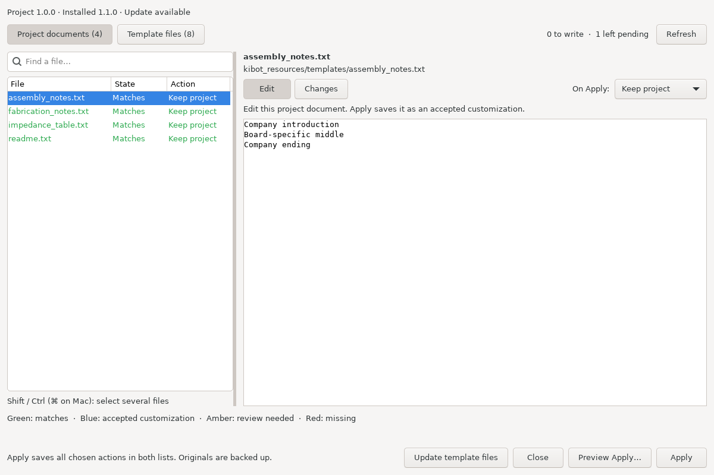

# Usage and recovery

## Compatibility and sources

KiCad 9 and 10 are supported. Project Setup and template review expect the KiBot layout
described below; design rules and stackup features also work with saved KiCad 9
projects without KiBot configuration. No particular organization’s template or
catalog is required. Templates and standards are separate local folders or Git
checkouts. Git is optional; the plugin never commits, pushes or runs CI.

On Overview, select a source with **Choose template…** or **Standards repository →
Change…**. Source paths are remembered on this computer. **Refresh** reloads
project files and the catalog. An installed template is the comparison source;
its version does not establish that it is the latest remote release.
Both source buttons use the same folder dialog, showing the current path with
Browse and Use folder controls.

For an existing Git checkout, **Git…** optionally links its origin URL and branch.
Automatic checks run in the background on open and every minute when enabled.
They fetch changed remote refs without modifying local source files. **Pull** is
explicit and uses a fast-forward update of the selected branch. Overlapping local
edits, diverged history and unfinished Git operations prevent pulling; unrelated
local edits are kept. The plugin never resets, stashes or switches branches.
After pulling, source comparisons and catalogs reload without reopening the plugin
or discarding Project Setup edits. Offline errors leave local sources usable.

## BOM and stock

Open **BOM & Stock** to price the saved schematic. Save schematic edits first;
unsaved editor changes are not included. **Reload BOM** reruns KiCad's BOM export,
excluding DNP parts, excluded components and test points. `TP` references followed
by a number and components with TestPoint/TestPad values or footprints are omitted
from imports, costing, stock lookups and assembly export. Mixed grouped CSV rows
retain their other components and adjust quantities accordingly.
LCSC detection runs separately for every component; no project-wide column
selection is needed. Dedicated fields such as
`LCSC`, `LCSC Part #`, and `JLCPCB Part Number` are recognized, along with
`Supplier Part Number`, `Alt Supplier Part Number 1` and ordinary `Part Number`
or `Alt Part Number` fields containing a C-number. Supplier labels are respected:
a DigiKey part number is not treated as LCSC. Manufacturer part numbers, values,
references and internal part numbers are not used as supplier assignments.

The primary LCSC part takes precedence over alternative supplier slots; otherwise
the first populated LCSC alternative is used. For example, a primary DigiKey part
with an LCSC alternate uses the alternate code; a primary LCSC part with another
LCSC substitute uses the primary code. Dedicated LCSC fields are authoritative;
conflicting fields at the same priority are reported instead of choosing one.
Select a row to see its detected source field(s). **Import CSV…** also accepts grouped
JLCPCB/KiCad BOMs with references, quantity, value and a part-number column.
**Use saved schematic** returns from an imported CSV to the project's schematic.

Tick **Exclude JLC** in the last column of a BOM row to leave that item out of
the JLCPCB assembly export. Untick it to include the item again. A grouped row applies to all of its
designators. Ticks are saved per project and retained through sorting, reloads,
stock refreshes and reopening the plugin. Excluded rows remain in the purchasing
list and cost estimate, which also accounts for components assembled separately.

**Export JLCPCB BOM…** saves a UTF-8 CSV with the columns `Comment`, `Designator`,
`Footprint`, `Quantity` and `LCSC Part #`, following
[JLCPCB's assembly BOM format](https://jlcpcb.com/help/article/how-to-generate-bom-and-centroid-files-from-kicad-8).
Save and Reload BOM first to include the latest schematic changes. The export
describes **one board** regardless of the Boards quantity: grouped designators
are written explicitly, separated by commas, with no reference ranges. Value
is copied into Comment even if the source also has a different Comment or MPN.
Quantity is the row's designator count on **one board**, without multiplying by
Boards or MOQ. The footprint's library prefix is removed. Cost grouping by
LCSC number never discards differing values or footprints in the assembly CSV.

Parts without a code are included with a blank LCSC cell and listed after export
for manual matching on JLCPCB. DNP parts, excluded parts and test points stay out.
Conflicting codes, missing values/footprints, duplicate designators (including case-only differences),
or quantities inconsistent with the explicit references must be corrected before
export. Export does not fetch prices or change the source BOM. The assembly order
also needs a separate component placement (CPL) file.

Change **Boards** to recalculate immediately from cached quantity price tiers.
Identical JLCPCB numbers are aggregated before choosing a tier. All prices are
USD, with the original supplier precision retained. **Needed / buy** shows an
additional purchase quantity when JLCPCB supplies a minimum purchase quantity;
that purchase quantity selects the supplier's unit-price tier and is used for
stock availability. **USD total**, **BOM total** and the per-board estimate count
only the required components: `unit price × parts per board × Boards`. Unused
components in a reel or MOQ do not inflate the board cost. For example, two
resistors at USD 0.0018 each contribute USD 0.0036 per board even if the supplier
requires buying 5,000. Manual paid prices also count only required components.
No fabrication, assembly, shipping, tax, or assembly attrition fees are included.
Missing prices produce an explicitly
incomplete subtotal rather than a zero price.

Click any column header to sort ascending; click it again to sort descending.
The arrow marks the active direction. Prices, totals, quantities and stock sort
numerically, and unavailable values stay at the bottom in either direction.
Sorting is retained during quantity changes and background refreshes, and edits
continue to apply to the selected component even when its row moves. Sort
**USD total** descending to find the largest contributors to the BOM cost.

The **Type** column shows JLCPCB's **Basic** or **Extended** classification, and
**Preferred** when explicitly supplied. Missing classifications are **Unknown**;
the plugin does not infer them from price or stock. Older cached entries refresh
in the background to retrieve this field. Manual prices do not change a part's
JLCPCB classification.

The tab uses anonymous JLCPCB component-page data, without an account, API key,
AI, local server or LCSC fallback. It refreshes stale components when opened,
with **Refresh JLCPCB**, and every 15 minutes while the tab is visible and
**Auto refresh** is enabled. Quantity changes never make network requests. Each
row shows when its stock/price was checked; shortages and changes since the
previous check are highlighted. Stock is shared supplier availability, not a
reservation. On errors, the last known values remain visible with the error;
the website endpoint can change independently of the plugin.

Select a row and choose **Set paid price…** (or double-click). Enter the total
paid and pieces purchased: USD 13 for 10 pieces gives USD 1.30 per component.
External and hand-soldered components can use manual prices without a JLCPCB
number. Assigned parts continue to receive JLCPCB stock checks even when their
price is manual. **Use JLCPCB price** removes the selected override. That action
is also available inside the price dialog and does not require a valid manual
amount or quantity. Clearing **Total paid** on an existing override and choosing
**Save** also restores supplier pricing. Parts without a supplier number return
to an unpriced state when their manual override is cleared.

Manual prices, JLCPCB export exclusions, board quantity and BOM source live in
the project's `kpm-bom.json`; keep that file with the project to carry these
choices between machines.
Overrides use a supplier part number or a value/footprint/manufacturer identity,
so ordinary reference reannotation preserves them. Changing the part identity
requires setting a new price. A paid-price entry is a planning price, not a count
of remaining owned inventory. Settings that cannot be read are reported and never
silently reset. Disposable supplier data lives separately in `bom-cache/` under
the plugin's per-user data directory. Deleting that cache preserves manual prices.

The data-access approach was informed by
[Bouni's JLCPCB Tools](https://github.com/Bouni/kicad-jlcpcb-tools).
The client reads the JLCPCB component-detail endpoint; its `priceList`,
`jlcPrices` and `prices` catalog fields are supported without querying LCSC.

## Template review

**Update template files** on Overview or in the review window updates all shared
files from the selected local template in one action, with backups. It preserves
project metadata, workflow status, CI KiCad version and release history. Project
documents and project ignore rules stay untouched and pending decisions remain
available in review. Pull a configured source first to use its latest remote files.

A versioned template contains `kibot_resources/project_manager/template.json`.
New KiCad projects may carry a copy of that manifest. Older projects keep an
unknown history until reviewed. Sources with missing, added or modified managed
files must be restored or published as a new version before use; the status tooltip
and Activity list the affected paths. Downgrades and switching template identities are refused.

The managed inventory covers KiBot YAML, `.github/workflows/ci.yaml`,
`kibot_launch.sh`, all logos in `Logos/`, drawing sheets in `Templates/`, and supported resources in
`kibot_resources/{fonts,colors,scripts,templates}`. Board, schematic, project
settings, custom rules and extra project files are outside template upgrades.
Logo checks include nested folders, text SVGs and binary image files. Missing
files are reported even when project and installed template versions match;
reviewing **Use template** copies them into the project. Changed project logos
require review before replacement. Template maintainers must regenerate the
manifest with a new template version after adding files.

Maintenance files under `meta/`, including `meta/tests/`, are outside the required
inventory. The plugin manages only `.github/workflows/ci.yaml`; optional workflows
are neither installed nor updated. Existing local maintenance files are left alone.

Templates can also manage `.gitignore` with these exact section markers:

```gitignore
### TEMPLATE IGNORE RULES (managed by Project Manager)
# Shared patterns go here.
### PROJECT IGNORE RULES (add your rules below)
# Your additional patterns and !pattern overrides go here.
```

**Use template** updates only the shared section and preserves everything below
the project marker. When adopting an older, unmarked project `.gitignore`, all
its existing rules are retained in the project section for review. Later project
rules can override shared rules; Git requires ignored parent folders to be
re-included before their children. Older templates without these markers still
work and do not manage `.gitignore`. Customization status compares project
patterns in order, ignoring comments and blank lines. Removing your added rules
returns the row to green without rewriting your explanatory comments.

Templates may also include root `LICENSE` as a reviewed document. It uses the
same file list and **Keep project / Use template** actions as README sources and
notes. Older manifests that did not manage this file remain supported. The
licence text always comes from the selected template.

**Review adoption…** / **Review upgrade…** opens **Project documents** by default.
The left file list contains editable notes, README sources, `LICENSE` and managed
`.gitignore` files. **Template files** switches to shared YAML, scripts, fonts,
logos and other resources. Search filters the active list; the full path appears
above the selected file. Drag the vertical divider to give the editor more space.

Matches appear green, accepted customizations blue, differences needing review
amber and missing files red, with text labels. Matching and accepted files start
at **Keep project**; differences start at **Leave pending**. Shift-click selects
a range; Ctrl-click (Command on Mac) adds files. The action list offers choices
valid for the whole selection: **Keep project**, **Use template**, **Save edits**
for a single editable file, or **Leave pending**. Pending files stay unchanged.

A document opens in **Edit**. Typing stages **Save edits**; nothing is written
until Apply. The four standard sources are `fabrication_notes.txt`,
`assembly_notes.txt`, `impedance_table.txt` and `readme.txt` under
`kibot_resources/templates/`. Templates can declare additional plain documents
in their manifest. For `.gitignore`, edit only the project section; the shared
rules can be expanded for reading in a draggable 50/50 horizontal split. Saving project rules never silently upgrades
an outdated shared section: choose **Use template** for that update.

**Changes → Compare with template** is a reference comparison: red lines exist
only in the saved project, green lines only in the installed template. These
colors describe differences; they do not decide what Apply writes.
**Changes → Changes to apply** follows the selected action: Keep project and
Leave pending do not rewrite the file; Use template and Save edits show their
planned removals/additions. **Preview Apply…** shows all planned writes in color,
including staged document edits and review records.

Drafts and actions survive switching lists, files and search filters. **Refresh**
reloads both the project and installed template. Choices/drafts are retained for
unchanged files; changed files are rechecked. If a changed file has your draft,
refresh asks before discarding that draft. Cancel leaves the review intact.
Stored document baselines still support non-overlapping three-way merge proposals;
they no longer occupy a separate tab. Kept shared-file differences remain visible.

The standard seven-column impedance document opens in **Table**. Edit cells and
use **Add row** / **Delete selected rows**; padding and tabs are unnecessary.
Other headings or malformed CSV keep the ordinary text editor, so different
templates remain usable. Applying saves the same text document, with CSV quoting
and ordinary newlines.

If a standards folder is linked, **Add impedance profile** offers only presets
whose copper/dielectric construction matches the saved PCB. Save board changes
before importing. Import rereads the standards and board, appends missing targets
and preserves existing rows, including manual 50 Ω entries and tolerances. If
an existing target on the same signal/reference layers has a different width or
gap, it stays unchanged and the conflict is reported. Equivalent numeric/layer
spellings do not create duplicate rows. Missing source layers are reported;
source tolerance percentages are imported and missing tolerances remain blank.
When no profile matches, an orange message explains how to select a matching
stackup or add rows manually. Guidance does not calculate impedances
or modify routing, netclasses, the PCB, or the standards repository.

Put reusable new targets in that preset's `impedance_targets` in the standards
repo, then Refresh and add missing profiles. No match leaves import disabled;
the manual table remains editable. Multiple matching presets require a selection;
the importer does not offer guidance from different saved-board constructions.

Choose **Keep project → Apply** to accept a custom document. The choice and
reviewed template content are saved in `kibot_resources/project_manager/project.json`;
commit this file with the project so the decision survives reopening and cloning
on another computer. Accepted documents remain visible in blue with their diffs
available. You can continue editing them without another warning. The overall
status stays green and reports the accepted-customization count. When a later
template changes that particular document, it becomes amber for another review;
unrelated template updates do not invalidate your choice. Older accepted document
records keep their previous behaviour when opened by this plugin.

To change your mind, select a blue file and choose **Use template → Apply**.
After an overwrite confirmation and backup, it returns to green. Later edits to
that restored default need a new Keep decision. Editing a document in the review
window and applying it also records an accepted customization. Shared automation
files and the shared `.gitignore` section still flag differences even when kept.

To restore a default README, select `readme.txt` in **Project documents** and
choose **Use template → Apply**. Its previous content is backed up after an
overwrite warning. CI regenerates root `README.md` on its next run; you can edit
the source again afterwards. Missing README sources remain required.

**Apply** saves directly and keeps review open with refreshed results. Repeat it
for another batch. **Preview Apply…** shows the writes; accepting that preview
applies the reviewed plan and keeps review open too. Closing review retains anything already applied. Unapplied drafts stay only in
this window; save them before closing.
Undecided files keep their contents and previous baselines. The recorded template
version identifies the reviewed source; outstanding differences still determine
whether the project matches. Commit the records in
`kibot_resources/project_manager/` with the project.



## Project Setup

Setup edits `definitions` metadata in `kibot_yaml/kibot_main.yaml` and the workflow’s
`env.kibot_variant` and **KiCad version for CI** (`env.kicad_version`). Authors share the existing `DESIGNER` field. An optional
`REVIEWER` is added only when entered. Missing workflows are added through template
review; workflow status stays unavailable until the file exists.

Authors and reviewers accept multiple names separated by commas or semicolons.
The form uses two columns, with Apply and Preview kept outside the scrolling area.
Mouse-wheel scrolling over dropdowns scrolls the surrounding form where available
and does not change the selected value.

After **Apply**, a green message confirms that changes were saved and remains
visible after refresh. Save failures show a red message and an error dialog;
your edits remain available to correct or retry. Editing a field clears the
previous outcome. Applying unchanged values shows “No changes to save.”

**DRAFT**, **PRELIMINARY** and **CHECKED** select the workflow’s documentation/check
mode. Version tags control **RELEASED**. KiBot propagates metadata into text
variables and reports on the next run. Saving setup does not run checks or
establish that an electrical design has been verified.

In a KiCad 10 editor, an existing KiCad 9 CI target is suggested as **KiCad 10**.
The message identifies the mismatch; **Apply** saves the selected target into the
workflow. Opening the plugin alone changes no files. A newer CI target is never
automatically downgraded. Template updates preserve this project choice; use
Project Setup to change it. Files saved with KiCad 10 need a KiCad 10 CI target.

Existing values, scalar quoting, comments, newline conventions and branch policies
are preserved where supported. Templates substitute metadata into multiple YAML
contexts, so apostrophes, `colon: space`, comment sequences, macro expressions and
ambiguous YAML scalars are rejected with an explanation. Multiline scalars and
anchors on managed fields are unsupported. Unexpected layouts are rejected.

Template comparison ignores allowed metadata values, workflow status, CI KiCad version and standard
numbered changelog title/body extraction entries; other shared configuration stays
checked. When uncommenting release entries, align `- variable` with the other
list entries and indent `command` two spaces further.

## Board release preparation

Select **CHECKED** in Project Setup to show **Prepare a board release**. Edit the
Markdown below `## [Unreleased]` in `CHANGELOG.md`; older version sections and link
definitions remain outside this editor. A missing changelog can be created here.
Enter a version such as `1.0.0` to enable its two title/body variable-command pairs
in `kibot_yaml/kibot_pre_set_text_variables.yaml`. Existing standard examples are
uncommented with the correct indentation; new versions are inserted without
removing earlier entries. Customized commands and duplicate entries require manual
review. A version already present as a released changelog section cannot be reused.

The version field starts blank (**Unreleased**); enabled YAML history entries do
not select a release, because they may have been copied from another project.
Apply saves your explicit choice in `kibot_resources/project_manager/release.json`.
You can choose an earlier unissued version or clear the field, Apply, and reopen
without it jumping to another enabled history entry. Existing YAML history stays
intact. Once the chosen version appears in the released changelog, the field
returns to Unreleased. Template upgrades preserve the selection record.

The ordinary **Preview Changes…** and **Apply** include these files and the selection record along with
setup changes, with local backups and checks for intervening edits. They do not
create dated version headings, commits, pull requests or tags. Push CHECKED on
`dev`, wait for the workflow, merge the PR into `main`, then tag `main`. The existing
release workflow creates the dated version section and generates RELEASED outputs.
Versioned history values are populated once that dated section exists.

Leaving the version field checks the saved schematic; **Check schematic history**
repeats that inspection after you save changes. It follows the schematic's sheet hierarchy
and looks for the selected version's title and body placeholders in text or text
boxes. It reports missing placeholders and leaves the schematic untouched. Save
the sheets first and inspect their layout and the final generated schematic PDF;
finding a placeholder alone does not verify its rendered contents or position.

## Local checklist

**Checklist**, after Stackup, provides generic Designer, Outputs, Independent
review and Before ordering checks bundled with the plugin. It works without a
template, standards repository, Git or online account. Enter your reviewer name,
tick items and add comments. Checks save immediately; comments and the current
reviewer name save after a short pause. The save indicator confirms persistence;
comments also appear in the table. Each checked item
retains the name and date of the person who checked it. Later comment edits or
changing the current reviewer do not rewrite another person's recorded check.
Explain not-applicable items in comments before marking them reviewed.

Answers live in `kibot_resources/project_manager/review.json` under the project
(or standalone board folder). Old root-level `kpm-review.json` files are ignored
and are not migrated. Copy
or share this file with the project to retain the review on another computer.
Opening the panel creates no file until you save an answer or reviewer name.
Conflicting external edits are reported rather than overwritten.
**Tick all** uses the current reviewer for newly checked items; existing check
authors and comments stay intact. **Untick all** clears ticks and the completed
review snapshot while keeping comments. Recording a completed review displays
confirmation; incomplete checks or a missing reviewer produce an explanation.

During review, design saves do not clear ticks or mark individual items outdated.
After completing the checks, **Record completed review** stores the reviewer's
name, date and local content fingerprints of the saved board, project, custom
rules, schematic hierarchy and KiBot YAML when present. Later design changes show
one notice when you reopen the tab or Refresh; all checks and comments remain.
Saving unchanged files, editing the checklist, changing `.kicad_prl` editor
preferences or regenerating output files does not invalidate the snapshot.
The notice compares saved files; save editor changes before completing a review.
Revisit affected checks yourself and record the completed review again when done.
The checklist records human review and does not run checks or block ordering.

## Rules and stackups

Choose a folder containing `catalog.json`; see [the format](standards-format.md).
Select a preset and inspect its details. Rule comparisons show constraints,
custom rules and missing named netclasses, nets or areas. Applications preserve
project exceptions, schematic net assignments and unrelated settings.

Stackup shows the saved board and selected preset side by side, including
dielectric sublayers and surface properties. Mask, silkscreen and finish overrides
are explicit. A copper layer still used by the board cannot be removed. Matching
uses physical properties rather than preset names. Impedance guides describe
routing geometry; they do not assign nets or change widths.
Highlighted rows include change descriptions, with full values in the hover
tooltip and Details table, including dielectric constant and loss tangent.

Save and close both PCB and schematic editors before applying standards, then
reopen. `kpm-standards.json` records source hashes, presets and appearance choices.
Repeated application of unchanged settings makes no further file changes.

**Save as preset…** appears for a saved construction without a catalog match.
Save the board first; editors may remain open for capture. Enter metadata and
optional impedance guides, review duplicate/similar constructions and save one
new JSON file. Saving refuses an existing destination or changed source/catalog.
It refreshes the catalog and selects the new preset without changing the board.

## Backups and troubleshooting

Overview’s **Open Backups** and activity log show backup locations. User settings
and backups are outside the project:

| Platform | Directory |
| --- | --- |
| Linux | `${XDG_DATA_HOME:-~/.local/share}/kicad_project_manager/` |
| macOS | `~/Library/Application Support/kicad_project_manager/` |
| Windows | `%LOCALAPPDATA%\kicad_project_manager\` |

Each backup includes original files and a `manifest.json`. To restore, close the
plugin and editors, review any later changes, then copy originals to their
project-relative paths. An entry with `existed: false` identifies a newly created
file: remove that file when undoing the apply. A failed multi-file save rolls back
its writes when no external edit has intervened.

- **No toolbar button:** enable KiCad API, check Python/wxPython, recreate the
  plugin environment in Preferences → Plugins and restart PCB Editor.
- **Project unavailable:** save/open the board, close modal editor dialogs and Refresh.
- **Changed during review:** Refresh and review again; external edits are preserved.
- **Configuration/workflow missing:** select a compatible versioned template and
  add it through template review. The source picker starts in KiCad’s user template
  folder; `KICAD_USER_TEMPLATE_DIR` overrides that location.
- **Previously installed PCM copy:** uninstall it before installing the generic
  `org.kicadprojectmanager.plugin` package. Existing projects and user backups stay in
  their current locations.
